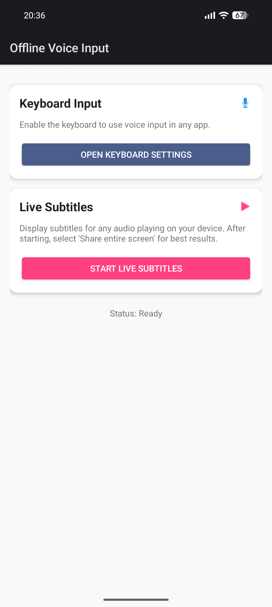

# Offline Voice Input (Android)

An offline, privacy-focused speech-to-text tool for Android, built with Rust. Tap the microphone on the keyboard you already use — your speech is transcribed entirely on-device and typed into any app. Also includes live subtitles and an optional dedicated voice keyboard.

[](https://github.com/notune/android_transcribe_app/releases/latest)
[](https://play.google.com/store/apps/details?id=dev.notune.transcribe)
[](https://apps.obtainium.imranr.dev/redirect?r=obtainium://app/%7B%22id%22%3A%22dev.notune.transcribe%22%2C%22url%22%3A%22https%3A%2F%2Fgithub.com%2Fnotune%2Fandroid_transcribe_app%22%2C%22author%22%3A%22notune%22%2C%22name%22%3A%22Offline%20Voice%20Input%22%2C%22additionalSettings%22%3A%22%7B%5C%22apkFilterRegEx%5C%22%3A%5C%22fdroid%5C%22%2C%5C%22invertAPKFilter%5C%22%3Atrue%7D%22%7D)

## Features

- **Voice input in any app:** Tap the microphone on the keyboard you already use (SwiftKey, etc.) or a website's voice search, and your speech is transcribed straight into the text field. The app registers as your device's speech-to-text provider.
- **100% offline & private:** The Parakeet TDT model runs entirely on-device — no audio ever leaves your phone, and no network is required.
- **Live Subtitles:** Real-time captions for any audio/video playing on your device.
- **Optional voice keyboard:** A built-in keyboard you can switch to for voice input wherever you prefer it.
- **Supported Languages:** Bulgarian, Croatian, Czech, Danish, Dutch, English, Estonian, Finnish, French, German, Greek, Hungarian, Italian, Latvian, Lithuanian, Maltese, Polish, Portuguese, Romanian, Slovak, Slovenian, Spanish, Swedish, Russian, Ukrainian.
- **Custom models:** Import any [transcribe.cpp](https://github.com/handy-computer/transcribe.cpp) GGUF model (Whisper, Nemotron streaming, Canary, more Parakeet variants, …) from a downloaded file — the app stays fully offline; downloads happen in your browser.
- **Efficient native backend:** All models run through [transcribe.cpp](https://github.com/handy-computer/transcribe.cpp) (ggml), wrapped in a safe Rust core.

## Screenshots

<p float="left">
  
  
  
</p>

## Usage

### Voice input in any app (recommended)

1. Open **Offline Voice Input** once and grant the microphone permission. The home screen shows a **Voice input** status — green when you're ready to go.
2. In any app, tap the **microphone** on your keyboard (e.g. Microsoft SwiftKey) or the voice-search mic on a website. A compact panel slides up over the app you're in, you speak, and your words are inserted as text. Tap to stop — or enable *Auto-stop after silence* in the app's settings to have it stop by itself.

The app plugs into Android's speech-to-text in **three** ways, so it works with a wide range of keyboards and apps:

| Path | Who uses it | What happens |
|---|---|---|
| **Voice-input popup** (`RECOGNIZE_SPEECH`) | SwiftKey, website voice search, many apps | The compact bottom panel opens over the current app |
| **System speech service** (`RecognitionService`) | Keyboards/apps using Android's `SpeechRecognizer` | Recognition runs invisibly in the background with automatic endpointing |
| **Voice keyboard (IME)** | Any keyboard, via the keyboard switcher — also HeliBoard/AnySoftKeyboard-style "switch to voice IME" mic keys | The dedicated voice keyboard opens |

Tap **Try voice input** on the home screen to test the whole flow in one tap.

**Keyboard notes** (mic-key behavior verified against each keyboard's source and tested in the emulator):

- **Microsoft SwiftKey** (not open source) opens the compact voice panel directly, like website voice search does. If SwiftKey's own voice typing opens instead, go to SwiftKey Settings → *Rich input* → turn off **Multi-modal voice typing**.
- **AnySoftKeyboard** is the open-source way to get the panel: its mic key fires the standard speech intent as long as no *voice keyboard* is enabled on the system. (If one is enabled — ours or Google's — it switches to that instead.)
- **HeliBoard, FlorisBoard, OpenBoard, Fossify Keyboard, Unexpected Keyboard:** their mic key never opens the panel — it switches to the system *voice input keyboard*. Enable the **Offline Voice Input** keyboard (see below) and it opens automatically; its keyboard-switch key takes you back. **FUTO Keyboard** ships its own built-in voice input.
- **Gboard:** only uses Google's own voice typing, so it can't hand speech to this app at all.
- If Android shows a chooser, pick **Offline Voice Input** and tap **Always**. If another app always opens, clear its default in *Settings → Apps*.

### Dedicated voice keyboard (optional)

Prefer voice input as its own keyboard? Enable the **Offline Voice Input** keyboard via *Open Keyboard Settings* on the home screen, switch to it from your keyboard switcher, then tap **Tap to Record**. By default the recording keeps running even if you switch apps or the keyboard closes (turn off *Record in background* in settings if you don't want that) — the text is inserted when you come back.

### Live subtitles

Tap **Start Live Subtitles** and choose *Share entire screen* to get real-time, on-device captions for any audio or video playing on your device.

**Advanced: skip the screen-capture dialog.** Android shows a "Start recording or casting?" consent dialog every time subtitles start. You can pre-approve it once via adb — after that, subtitles start instantly and the setting survives reboots (USB debugging can be turned off again afterwards):

```bash
adb shell appops set --user 0 dev.notune.transcribe PROJECT_MEDIA allow
```

To undo it:

```bash
adb shell appops set --user 0 dev.notune.transcribe PROJECT_MEDIA default
```

This relies on the undocumented `PROJECT_MEDIA` app-op; on some OEM builds it may not work or may get reset by the system — the normal dialog remains the fallback. The same instructions are shown in-app under *Skip the permission dialog (advanced)*.

### Custom speech models

The built-in Parakeet model works out of the box. (The F-Droid build has no built-in model, since F-Droid builds everything from source: on first start, the app shows how to download the same model in your browser and import it. The F-Droid build is reproducible and carries the same signature as the GitHub releases, which also include it as `…_fdroid.apk`, so you can switch between the GitHub/Obtainium and F-Droid versions without reinstalling.) Under **Manage speech models** you can additionally import any [transcribe.cpp](https://github.com/handy-computer/transcribe.cpp) GGUF model: download a `.gguf` file in your browser (the in-app *Where to get models* dialog lists direct links, e.g. a tiny 135 MB English-only Parakeet, the multilingual Nemotron 3.5 streaming model with punctuation, or Whisper large-v3-turbo), then import it via the system file picker and select it. The app itself needs no internet permission — model files are simply copied into the app's private storage. An optional language hint (e.g. `en-US`, or `auto`) can be set for imported models.

Large models occupy space twice during import: once in Downloads and once in the app. Keep at least the size of the model plus 64 MiB free after downloading it. Once the imported model is selected, you can remove the original from Downloads.

### Transcribe a recording

In your file manager, open a WAV in a language your model supports with **Offline Voice Input**. You can also share an audio file to the app. It transcribes with the selected model and shows a **Copy to clipboard** button when finished. For an English example with a larger custom model, see the [Fourier 2B import and file-transcription walkthrough](https://huggingface.co/oruk/oruk-fourier-2b/blob/main/examples/android/README.md) (2.19 GB, CC BY-NC 4.0).

## Prerequisites

| Dependency | Installation |
|---|---|
| **JDK 17** | Android Studio (bundled) or `sudo pacman -S jdk17-openjdk` |
| **Android SDK** | Via Android Studio or `sdkmanager` |
| **Android NDK** | `sdkmanager "ndk;28.0.13004108"` |
| **Rust** | [rustup.rs](https://rustup.rs) + `rustup target add aarch64-linux-android` |
| **cargo-ndk** | `cargo install cargo-ndk` |

### Local Configuration

Create a `local.properties` file in the project root (this file is gitignored):

```properties
sdk.dir=/path/to/your/Android/Sdk
```

Gradle uses `JAVA_HOME`. If your default Java is not JDK 17 (Gradle 8.9 can't run on JDK 22+), point Gradle at one in your user-level `~/.gradle/gradle.properties` instead of the project file:

```properties
org.gradle.java.home=/path/to/jdk17
# Examples:
#   /opt/android-studio/jbr          (Android Studio bundled JBR, if it is JDK 17/21)
#   /usr/lib/jvm/java-17-openjdk     (System JDK 17)
```

## Building

The app has two build flavors: `standard` (GitHub releases, Google Play) bundles the Parakeet model, `fdroid` is the same app without it.

### Debug APK
```bash
./gradlew assembleStandardDebug
# Output: app/build/outputs/apk/standard/debug/app-standard-debug.apk
```

### Release APK
```bash
./gradlew assembleStandardRelease
# Output: app/build/outputs/apk/standard/release/app-standard-release.apk
```

### Release AAB (Google Play)
```bash
./gradlew bundleStandardRelease
# Output: app/build/outputs/bundle/standardRelease/app-standard-release.aab
```

### F-Droid flavor (no bundled model)
```bash
./gradlew assembleFdroidRelease
# Output: app/build/outputs/apk/fdroid/release/app-fdroid-release.apk
```

### Signing

For release builds, place a `release.keystore` in the project root and set these environment variables:

```bash
export KEY_ALIAS=release
export KEY_PASS=yourpassword
export STORE_PASS=yourpassword
```

### Model Assets

The built-in Parakeet TDT GGUF model (~485 MB) is automatically downloaded from HuggingFace during the first `standard` build via a Gradle task. The checksum is verified with SHA-256. No manual download is needed. `fdroid` builds never download it.

## Project Structure

```
├── app/
│   └── src/main/
│       ├── AndroidManifest.xml
│       ├── java/dev/notune/transcribe/   # Android Java code
│       ├── res/                          # Resources (layouts, drawables, etc.)
│       ├── assets/                       # Model files (downloaded at build time)
│       └── jniLibs/                      # Native .so files (built by cargo-ndk)
├── src/                                  # Rust source code (cdylib)
├── Cargo.toml                            # Rust crate manifest
├── build.gradle.kts                      # Root Gradle config
├── app/build.gradle.kts                  # App module config (AGP 8.13.2)
├── settings.gradle.kts
├── gradle.properties
└── fastlane/metadata/android/            # F-Droid store listing
```

## Acknowledgments

- **Speech Model:** [Parakeet TDT 0.6b v3](https://huggingface.co/nvidia/parakeet-tdt-0.6b-v3) by NVIDIA.
    - GGUF conversion by [handy-computer](https://huggingface.co/handy-computer/parakeet-tdt-0.6b-v3-gguf).
    - Licensed under [CC-BY 4.0](https://creativecommons.org/licenses/by/4.0/).
- **Inference Backend:** [transcribe.cpp](https://github.com/handy-computer/transcribe.cpp) by CJ Pais / Handy Computer.

## License

[MIT](LICENSE)
