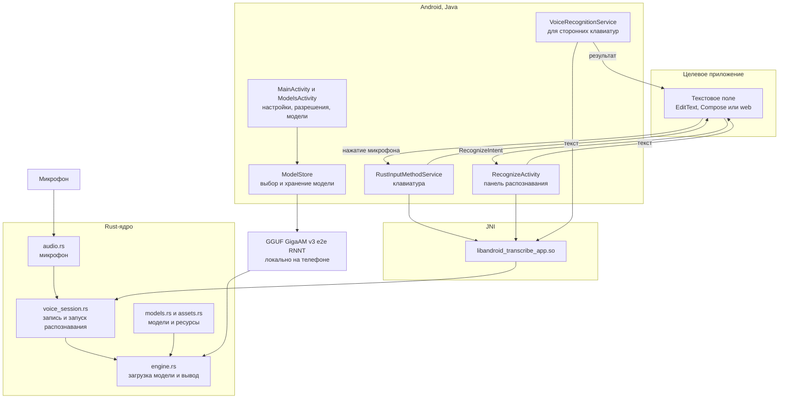
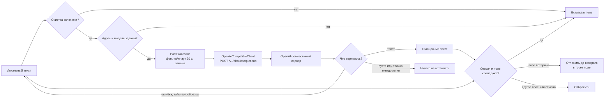
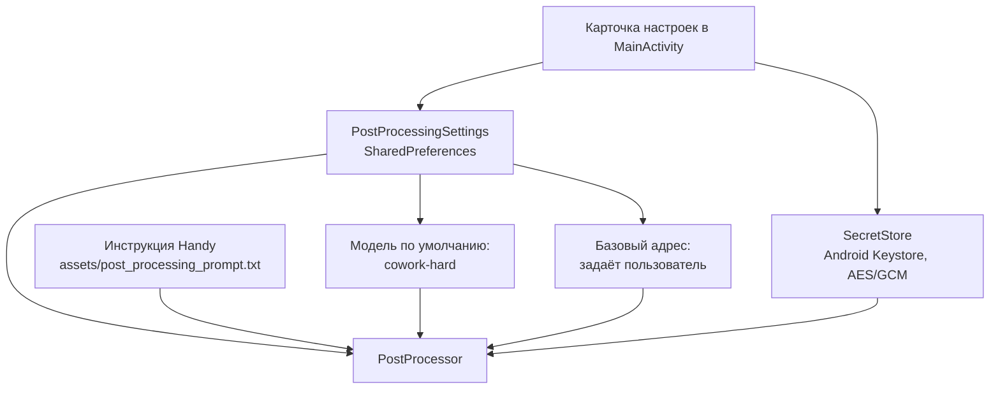
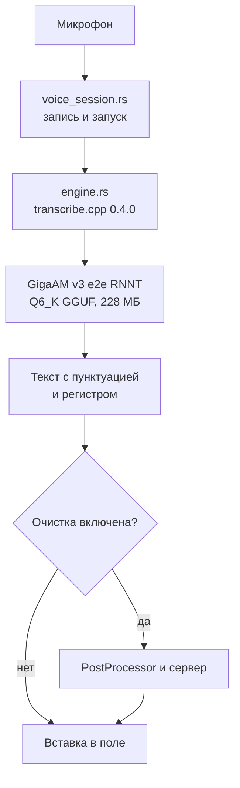
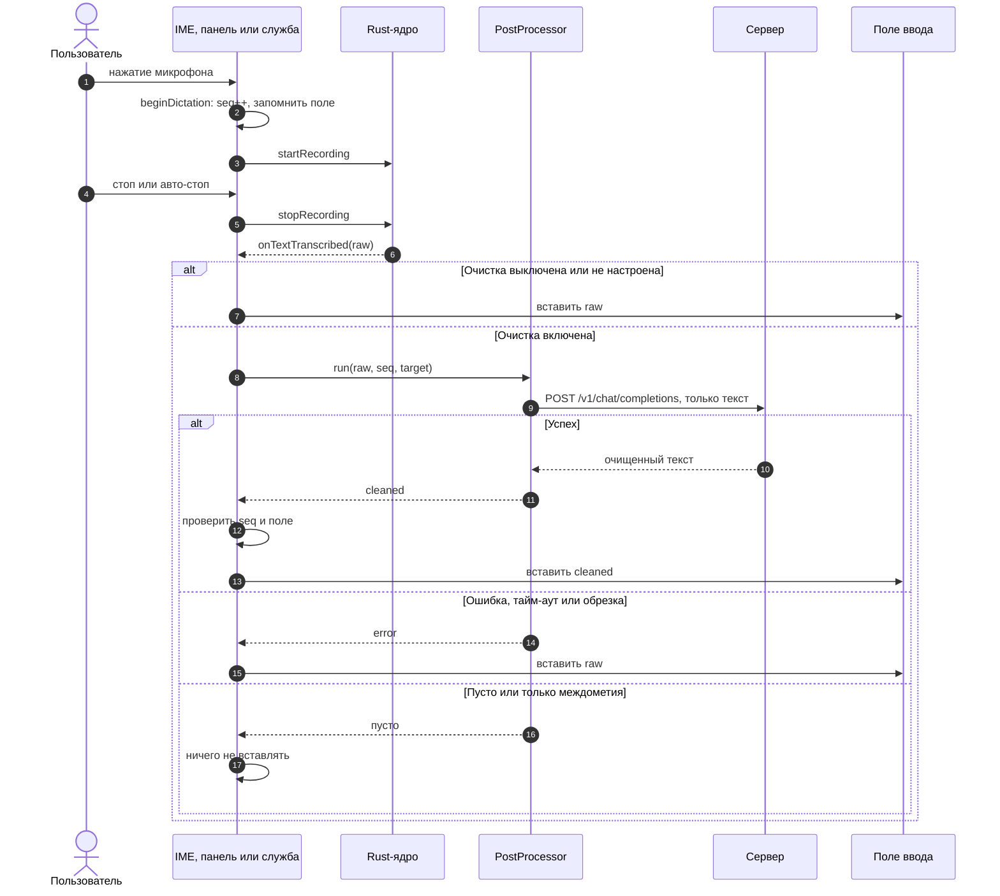
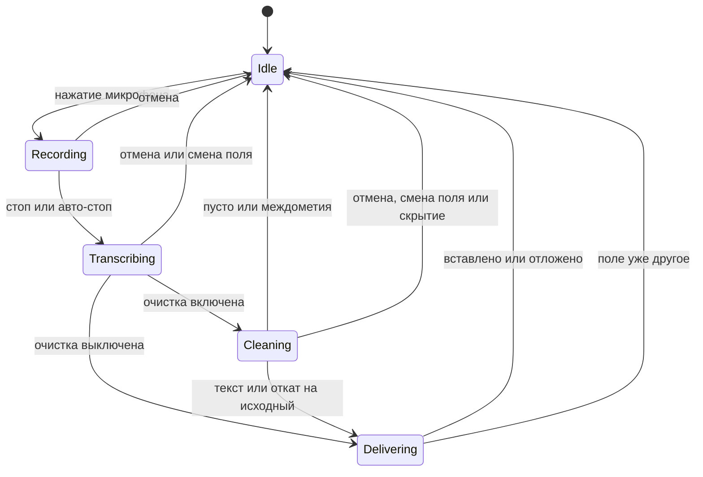
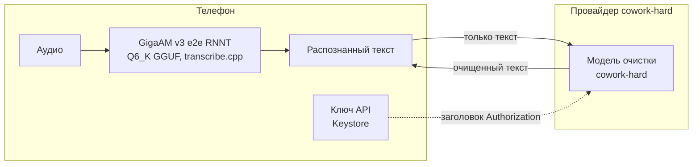

# Архитектура Offline Voice Input с постобработкой

Документ описывает два состояния: исходную версию v0.2.3 и рабочую ветку
`feature/handy-post-processing`. Схемы нужны, чтобы отделить локальное
распознавание от необязательной сетевой очистки и увидеть, где именно
проходят границы данных, отмены и вставки.

## 1. Исходная версия v0.2.3

Ключевая особенность: текст появляется только после локального
распознавания. Аудио, модель и промежуточные буферы остаются на телефоне.
Вставка выполняется тремя разными способами, поэтому поведение нужно
проверять в каждом из трёх путей.

Это историческая база. В рабочей ветке встроенная модель заменена на GigaAM,
а `transcribe.cpp` остаётся тем же движком: GigaAM v3 добавлена в него как
отдельная архитектура. См. раздел 3.

## 2. Что добавлено в рабочей ветке

Новый слой не заменяет распознавание, а вставляется между локальным текстом
и вставкой. Его можно выключить, и тогда поведение возвращается к v0.2.3.

Настройки и секреты:

Инструкция взята из Handy без изменений и лежит в
`app/src/main/assets/post_processing_prompt.txt`, копия для правок в
`prompts/handy-post-processing-ru.txt`. Ключ выдаётся для провайдера, на
котором работает модель `cowork-hard`; базовый адрес вводит пользователь,
в коде его нет.

## 3. Замена распознавания: GigaAM вместо Parakeet

Решение: считать русскую речь должна GigaAM v3 от Сбера, локально на
телефоне. Переход не требует нового рантайма. `transcribe.cpp` версии 0.4.0
уже содержит архитектуру `gigaam`, поэтому меняется модель и настройки,
а не движок.

Что известно по первоисточнику:

| Свойство | Значение |
|---|---|
| Модель | `gigaam-v3-e2e-rnnt-Q6_K.gguf` |
| Источник | `handy-computer/gigaam-v3-e2e-rnnt-gguf`, ревизия `3efd5b3` |
| SHA-256 файла | `1ef0f771d9ab0b0675c45ce67a3e5b79ac7497fe35ebb08a51704c4ee423edce` |
| Размер | 227 953 952 байта, около 228 МБ |
| Лицензия | MIT |
| Язык | русский, без перевода |
| Пунктуация | есть, вместе с регистром: `e2e` использует SentencePiece |
| WER FLEURS ru | 5.37 процента по данным автора конвертации |
| Скорость | RTF 28.85 на CPU Apple M4 Max, это не замер телефона |
| Длинное аудио | окна по 25 секунд с перекрытием, нарезка внутри модели |

Что это меняет в архитектуре:

- нового рантайма нет: остаётся `transcribe.cpp`, ONNX Runtime и sherpa-onnx
  не нужны;
- встроенная модель в сборке `standard` это GigaAM Q6_K, Parakeet Q4_K_M
  больше не скачивается при сборке;
- Parakeet и другие GGUF остаются доступными для импорта и скачивания, потому
  что приложение многоязычное, а GigaAM понимает только русский;
- `standard` и `fdroid` сохраняют прежний смысл: `standard` несёт модель,
  `fdroid` предлагает скачать её в браузере;
- очистка текста остаётся полезной: GigaAM даёт пунктуацию и регистр, но не
  восстанавливает термины и имена.

Что уже проверено и что нет:

- проверено, что версия `transcribe-cpp-sys 0.4.0` в проекте содержит
  `src/arch/gigaam` с вариантами `e2e_rnnt`, `e2e_ctc`, `rnnt`, `ctc`;
- проверено, что файл модели опубликован с указанным SHA-256 и размером;
- не проверено на телефоне: задержка, память, расход батареи и качество
  на реальном микрофоне;
- не проверено на русской речи в этой среде: для этого нужен прогон
  на устройстве или локальный стенд с моделью.

Выбор `e2e_rnnt` против `e2e_ctc`: RNNT выбран пользователем 26.11.2026.
Q6_K выбран как компромисс: WER 5.37 против 5.35 у F32, размер 228 МБ
против 890 МБ.

## 4. Путь одной диктовки

## 5. Состояния диктовки и откаты

Правила, которые удерживают состояние:

- у каждой диктовки свой номер `seq`;
- результат несёт номер сессии и описание поля `EditorTarget`;
- при смене поля, отмене или новой записи старый результат не вставляется;
- если поле временно потеряло фокус, текст ждёт возврата в то же поле;
- тайм-аут и ошибка всегда возвращают управление, а не оставляют клавиатуру
  в состоянии «Очищаю текст».

## 6. Граница данных

Наружу уходит только распознанный текст, инструкция и имя модели. Аудио
не покидает телефон: GigaAM считает на устройстве. Ключ хранится на
телефоне в зашифрованном виде и передаётся провайдеру как обычный
заголовок авторизации.

## 7. Карта файлов

| Слой | Файл | Роль |
|---|---|---|
| Настройки | `MainActivity.java` | карточка очистки, проверка связи, инструкция |
| Настройки | `PostProcessingSettings.java` | адрес, модель, переключатель, инструкция |
| Секреты | `SecretStore.java` | ключ в Android Keystore, AES/GCM |
| Сеть | `OpenAiCompatibleClient.java` | HTTP-запрос, тайм-аут, разбор ошибок |
| Сеть | `PostProcessingLogic.java` | URL, JSON, ответ, очистка, междометия |
| Потоки | `PostProcessor.java` | фон, сторожевой таймер, отмена |
| Поле | `EditorTarget.java` | идентичность поля для безопасной вставки |
| IME | `RustInputMethodService.java` | основной путь, сессии, вставка, откат |
| Панель | `RecognizeActivity.java` | второй путь, результат через Intent |
| Служба | `VoiceRecognitionService.java` | третий путь, результат через Callback |
| Ядро | `src/voice_session.rs` | запись и запуск распознавания |
| Ядро | `src/engine.rs` | загрузка модели и вывод, сейчас GGUF |
| Модель | `assets/builtin-model` | GigaAM v3 e2e RNNT Q6_K |
| Модели | `ModelsActivity.java` | список моделей для скачивания и импорт GGUF |
| Модели | `ModelStore.java` | встроенная GigaAM или файл пользователя |
| Инструкция | `app/src/main/assets/post_processing_prompt.txt` | промт Handy без изменений |
| Сборка | `app/build.gradle.kts` | скачивание GigaAM Q6_K с проверкой SHA-256 |

## 8. Что важно для полного цикла AEK

- Риск задачи: `standard`. Есть сеть, секрет, UI и несколько путей вставки.
  Замена модели распознавания добавляет риск качества и памяти, но не нового
  нативного рантайма: движок прежний.
- Проверки: JVM-тесты, сборка, Android lint, реальный HTTP-запуск, проверка
  на телефоне, Visual QA для Android-интерфейса. Для GigaAM дополнительно
  нужны замеры WER на русской речи, времени распознавания и расхода памяти.
- Независимый проверяющий не должен идти тем же провайдером, что исполнитель.
- Публикация не планируется. По завершении корректно зафиксировать
  «принято, не выпущено».
- Главный блокер приёмки: нет реального прогона на телефоне с микрофоном,
  сменой полей и сервером пользователя.
